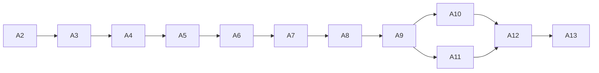

# Work split (5 people)

Team: Chirag, Manish, Dhanush, Rinisha, Irfan.

**Whole team:** L1 (Problem Discovery), L2 (Scope and Constraints) first, and L13 (Implementation Plan) last.
**Split among 5:** L3 to L12 (10 layers, 542 questions).

## 1. Dependencies

A layer cannot start until the artifacts it is built from exist (worksheet rule).

| Layer | Artifact | Built from | Qs | Who |
|---|---|---|---|---|
| 1 | A1 Product Requirements | — | 22 | **team** |
| 2 | A2 Scope and Constraints | A1 | 23 | **team** |
| 3 | A3 Incident and Evidence Catalog | A1, A2 | 37 | Dhanush (from Chirag) |
| 4 | A4 Requirements | A1, A2, A3 | 34 | Dhanush (from Chirag) |
| 5 | A5 Threat Model | A3, A4 | 28 | Chirag |
| 6 | A6 System Architecture | A4, A5 | 39 | Manish |
| 7 | A7 Data and Interface | A4, A6 | 64 | Manish |
| 8 | A8 Workflow | A6, A7 | 48 | Dhanush |
| 9 | A9 Agent Design | A3, A7, A8 | 53 | Dhanush |
| 10 | A10 Inference and Retrieval | A2, A9 | 64 | Irfan |
| 11 | A11 Safe Remediation | A5, A8, A9 | 92 | Rinisha |
| 12 | A12 Reliability and Evaluation | A3, A4, A10, A11 | 83 | all, by section |
| 13 | A13 Implementation Plan | A1–A12 | 58 | **team** |

**The chain is almost fully sequential.** Only **A10 and A11** can be built at the same time (both need A9, neither needs the other). They go to two different people. L12 is the other place where everyone can work at once, because its five sections are independent.

## 2. Owners

| Person | Theme | Layers | Qs |
|---|---|---|---|
| **Chirag** | Threats (back from Dhanush; L3, L4 stay with Dhanush) | L5 | **28** |
| **Manish** | Architecture and data | L6, L7 | **103** |
| **Dhanush** | Incident domain, requirements, workflows, agents | L3, L4, L8, L9 + L12 sections A, C | 71 + 101 + 36 = **208** |
| **Rinisha** | Safe remediation | L11 + L12 section B | 92 + 13 = **105** |
| **Irfan** | Models, retrieval and evaluation | L10 + L12 sections D, E | 64 + 34 = **98** |

Total 542.

Why this grouping:
- **Dhanush (from Chirag)** carries how incidents happen (L3) and what the system must do (L4). **Chirag** takes back what can go wrong (L5). Dhanush also takes L12-A (self-observability), which uses the same incident vocabulary.
- **Manish** owns the two linked design layers: components (L6), then data and interfaces (L7).
- **Dhanush** owns long-running workflows (L8) and the agent that runs inside them (L9). L12-C is backup and disaster recovery, which follows from the workflow state design.
- **Rinisha** owns the controlled change path (L11). It answers the threats from L5. L12-B (operational reliability) follows from it.
- **Irfan** owns models and retrieval (L10). L12-D and E (evaluation, experiments) test the model and agent behaviour.

## 3. L12 split (all five, one wave)

| L12 section | Qs | Owner |
|---|---|---|
| A Self-observability | 20 | Dhanush (also merges L12 and checks it against A3 and A4) |
| B Operational reliability | 13 | Rinisha |
| C Backup and disaster recovery | 16 | Dhanush |
| D Evaluation engineering | 21 | Irfan |
| E Controlled experimentation | 13 | Irfan |

## 4. Order of work

| Wave | Layer | Owner | Others meanwhile |
|---|---|---|---|
| 0 | L2 | whole team | — |
| 1 | L3 | Dhanush | Prepare (see rules) |
| 2 | L4 | Dhanush | Prepare |
| 3 | L5 | Chirag | Manish prepares L6 |
| 4 | L6 | Manish | Dhanush prepares L8 |
| 5 | L7 | Manish | Dhanush prepares L8 and L9. Rinisha, Irfan can help on L7 sections D and E. |
| 6 | L8 | Dhanush | Rinisha prepares L11. Irfan prepares L10. |
| 7 | L9 | Dhanush | Rinisha and Irfan prepare |
| 8 | **L10 ∥ L11** | Irfan ∥ Rinisha | Manish, Dhanush prepare L12 and review |
| 9 | L12 | all five, by section | — |
| 10 | L13 | whole team | — |

## 5. Rules for keeping everyone busy

1. **Prepare.** While a layer is written, the next owners read their questions and list knowns, unknowns and assumptions. They do not write the artifact until its inputs exist.
2. **Consumer reviews producer.** The owner of the next layer reviews each finished artifact (Manish reviews A5, Dhanush reviews A7, Rinisha and Irfan review A9).
3. **Help on big layers.** A free person may take lettered sections of the layer in progress. The owner merges. Best candidates: L7 (D, E), L8 (D), L9 (E, F).
4. **Whole team still discusses every question.** The owner drafts, runs the agent conversations, writes the log rows, and builds the artifact.

## 6. Risks

- **Dhanush owns L3–L4 and L8–L9** (208 questions, about twice anyone else). Chirag returned and took back L5 (2026-11-14). Consider moving L12-A to Chirag as well. Use rules 1–3.
- **Manish owns two layers in a row** (waves 4–5). Use rule 3 on L7.
- **The critical path is 10 waves after L2.** One slow layer delays the end. Keep each layer to one working session, and keep V1 simple.
